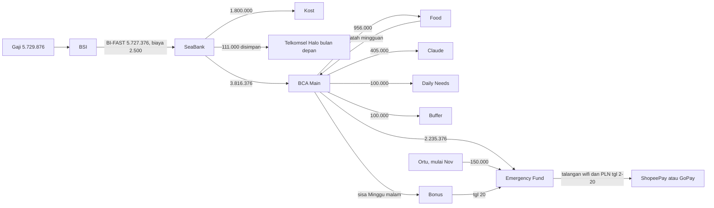

# Alur Keuangan Pribadi Dzaky

- **Versi:** 21 Okt 2026 (berlaku mulai gajian 21 Okt 2026)
- **Fungsi dokumen:** acuan alur uang bulanan sekaligus bahan spesifikasi aplikasi finance management pribadi
- **Satuan:** semua angka dalam Rupiah

---

## 1. Ringkasan

| Item | Periode 21 Okt | Mulai 21 Nov |
|---|---|---|
| Gaji (masuk tgl 21, biasanya sore) | 5.729.876 | 5.729.876 |
| Total pengeluaran | 4.126.500 | 3.976.500 |
| Simpanan ke Emergency Fund | 1.603.376 | 1.753.376 |
| Persentase simpanan | 28,0% | 30,6% |
| Biaya admin rutin | 22.500 | 22.500 |
| Bantuan ortu (khusus utils) | 0 | 150.000 |

- **Periode anggaran:** tgl 21 sampai tgl 20 bulan berikutnya
- **Pos yang dihapus:** transport (jalan kaki, ojek darurat dari Buffer) dan air galon

---

## 2. Akun

| Akun | Peran | Saldo setelah semua alur selesai |
|---|---|---|
| BSI | Rekening penerima gaji | 0 |
| SeaBank | Pusat pembagian gaji, bayar kost dan Telkomsel Halo | 0 setelah kost dan Halo dibayar |
| BCA (myBCA, Poket Rupiah) | Simpanan, makan, langganan, kebutuhan harian | lihat bagian 3 |
| ShopeePay dan GoPay | Bayar wifi dan PLN, pilih yang promonya lebih besar | top up seperlunya |
| Jago | Tidak dipakai lagi (transport dihapus) | 0 |

---

## 3. Poket BCA

| Poket | Fungsi | Isi tiap gajian | Aturan |
|---|---|---|---|
| Main (rekening induk) | Belanja harian, admin BCA | 20.000 + jatah makan mingguan | Admin BCA 20.000 dipotong awal bulan. Minggu malam sisa disapu ke Bonus |
| Emergency Fund | Dana darurat dan talangan wifi + PLN | 2.235.376 (Nov: + 150.000 dari ortu) | Tidak dikunci karena dipakai talangan tiap bulan |
| Food | Jatah makan sebulan | 956.000 | Tiap Senin pindah jatah seminggu ke Main |
| Claude | Langganan Claude | 405.000 | Pindah ke Main sebelum tanggal tagihan. Sisa ke Bonus, kekurangan karena kurs ditutup dari Bonus |
| Daily Needs | Sabun, sampo, odol, deterjen atau laundry, potong rambut | 100.000 | Sisa akhir periode ke Bonus |
| Buffer | Dadakan kecil: obat ringan, ongkos mendadak, ojek saat hujan atau telat | 100.000 | Sisa menumpuk sampai 300.000, lebihnya ke Emergency Fund |
| Bonus | Nampung sisa anggaran | 0 | Tgl 20 dipindah ke Emergency Fund atau Device Fund |
| Birthday (sementara) | Ulang tahun 24 Okt 2026 | 80.000 dari Emergency Fund | Sisa ke Bonus, poket ditutup setelah dipakai |

---

## 4. Anggaran bulanan

| Pos | Hitungan | Disimpan di | Periode 21 Okt | Mulai 21 Nov |
|---|---|---|---|---|
| Kost | | SeaBank | 1.800.000 | 1.800.000 |
| Claude | | BCA Claude | 405.000 | 405.000 |
| Kuota Telkomsel Halo | | SeaBank | 111.000 | 111.000 |
| Utils (wifi 237.000 + PLN 395.000) | Mulai Nov dibantu ortu 150.000 | BCA Emergency Fund | 632.000 | 482.000 |
| Makan | Lihat bagian 5 | BCA Food | 956.000 | 956.000 |
| Daily Needs | | BCA Daily Needs | 100.000 | 100.000 |
| Buffer | | BCA Buffer | 100.000 | 100.000 |
| Admin (+ transfer) | BI-FAST 2.500 + admin BCA 20.000 | BSI dan BCA Main | 22.500 | 22.500 |
| **Total pengeluaran** | | | **4.126.500** | **3.976.500** |
| Gaji | | BSI | 5.729.876 | 5.729.876 |
| **Sisa ke Emergency Fund** | | BCA Emergency Fund | **1.603.376** | **1.753.376** |

Catatan utils:
- PLN dianggarkan pakai angka paling tinggi (395.000), biasanya sekitar 385.000
- Utils adalah tagihan listrik dan wifi rumah asal, bukan biaya kost

---

## 5. Makan

| Jenis hari | Hari per bulan | Siang | Malam | Per hari | Sebulan |
|---|---|---|---|---|---|
| Kerja biasa | 14 | 20.000 | 18.000 | 38.000 | 532.000 |
| Puasa Senin-Kamis (mulai 26 Okt 2026) | 8 | puasa | 23.000 (buka) | 23.000 | 184.000 |
| Libur Sabtu-Minggu | 8 | | 30.000 | 30.000 | 240.000 |
| **Total** | **30** | | | | **956.000** |

Per waktu makan:

| Waktu makan | Hitungan | Sebulan |
|---|---|---|
| Siang hari kerja biasa | 20.000 x 14 | 280.000 |
| Malam hari kerja biasa | 18.000 x 14 | 252.000 |
| Malam hari puasa (buka) | 23.000 x 8 | 184.000 |
| Malam hari libur | 30.000 x 8 | 240.000 |
| **Total** | | **956.000** |

Aturan makan:
- Jatah mingguan Food ke Main sekitar 220.000 (3 hari biasa + 2 hari puasa + 2 hari libur)
- Realisasi di bawah anggaran masuk Bonus lewat sapuan Minggu malam
- Periode 21 Okt - 20 Nov punya 23 hari kerja (15 biasa + 8 puasa), anggaran memakai 22. Kelebihan 1 hari biasa (sekitar 38.000) ditutup dari Bonus atau Buffer

---

## 6. Alur gajian tgl 21

| Langkah | Dari | Ke | Nominal | Biaya |
|---|---|---|---|---|
| 1 | Kantor | BSI | 5.729.876 | |
| 2 | BSI | SeaBank | 5.727.376 | 2.500 (BI-FAST) |
| 3 | SeaBank | BCA Main | 3.816.376 | 0 |
| 4 | BCA Main | Emergency Fund | 2.235.376 | 0 |
| 5 | BCA Main | Food | 956.000 | 0 |
| 6 | BCA Main | Claude | 405.000 | 0 |
| 7 | BCA Main | Daily Needs | 100.000 | 0 |
| 8 | BCA Main | Buffer | 100.000 | 0 |
| 9 | SeaBank | Pemilik kost | 1.800.000 | 0 (sesuai tanggal tagihan kost) |
| 10 | SeaBank | Disimpan untuk Telkomsel Halo bulan berikutnya | 111.000 | |
| 11 (mulai Nov) | Ortu | BCA Emergency Fund | 150.000 | |

Isi Emergency Fund tiap gajian:
- Periode 21 Okt: simpanan 1.603.376 + utils 632.000 = 2.235.376
- Mulai 21 Nov: simpanan 1.753.376 + utils 482.000 = 2.235.376, ditambah 150.000 dari ortu

---

## 7. Kalender bulanan

| Waktu | Kejadian |
|---|---|
| Tgl 21 | Gajian, jalankan alur bagian 6 |
| Awal bulan | Admin BCA 20.000 dipotong dari Main |
| Tgl 2-3 | Tagihan PLN terbit. Cek promo ShopeePay, GoPay, dan PLN Mobile |
| Tgl 2-20 | Bayar wifi + PLN dari Emergency Fund (talangan). Bayar Telkomsel Halo dari SeaBank |
| Tgl 20 | Batas bayar PLN. Tutup periode: sapu Bonus dan sisa Daily Needs, cek Buffer |
| Tiap Senin | Pindah jatah makan mingguan dari Food ke Main |
| Tiap Minggu malam | Sisa di Main pindah ke Bonus (sisakan 20.000 menjelang awal bulan) |
| Tanggal tagihan Claude | Pindah dana Claude ke Main, selisih ke Bonus |

---

## 8. Aturan

1. Anggaran tetap. Realisasi di bawah anggaran dianggap bonus dan disimpan
2. Utils ditransfer penuh ke Emergency Fund tiap tgl 21 (632.000, atau 482.000 + 150.000 ortu) berapa pun tagihan aslinya. Selisihnya otomatis jadi tabungan
3. Tagihan yang batas bayarnya sebelum gajian (wifi, PLN, Telkomsel Halo) dibayar dari jatah gaji bulan sebelumnya atau talangan Emergency Fund
4. Emergency Fund hanya untuk:
   - Darurat besar: sakit, perangkat rusak, kehilangan kerja
   - Talangan tagihan yang jelas nominal dan tanggal kembalinya
   - Pengeluaran terencana yang dibatasi, contoh ulang tahun
5. Pengeluaran dadakan kecil diambil dari Buffer dulu, bukan dari Emergency Fund
6. Boros dadakan (jajan, mood) tidak boleh dari Emergency Fund. Tutup dari Bonus atau hemat di hari lain minggu itu
7. Setiap talangan dicatat: sumber, nominal, tanggal ambil, tanggal kembali, sumber pengembalian
8. Pilih e-wallet untuk tagihan berdasarkan total akhir: tagihan + admin - diskon atau cashback
9. Transfer kecil keluar BCA dihindari karena kena 2.500 per transaksi. Pindah antar poket BCA gratis
10. Patokan: kalau ada pertanyaan "beli atau tidak", tanya dulu "kalau tidak dibeli, ada masalah atau tidak"

---

## 9. Biaya admin

| Biaya | Nominal | Keterangan |
|---|---|---|
| BI-FAST BSI ke SeaBank | 2.500 | Sekali per bulan |
| Admin bulanan BCA | 20.000 | Kartu debit BCA hitam, dipotong awal bulan |
| Transfer SeaBank ke bank lain | 0 | Gratis dalam kuota bulanan SeaBank |
| Pindah antar poket BCA | 0 | Gratis |
| **Total per bulan** | **22.500** | |

---

## 10. Posisi tabungan dan proyeksi

Riwayat Emergency Fund:

| Tanggal | Kejadian | Perubahan | Saldo |
|---|---|---|---|
| Awal Okt 2026 | Tabungan awal | | 3.000.000 |
| 13 Okt 2026 | Talangan wifi + PLN Okt | -603.397 | 2.396.603 |
| 19-21 Okt 2026 | Talangan makan sebelum gajian | -130.000 | 2.266.603 |
| 21 Okt 2026 | Gajian: simpanan + utils | +2.235.376 | 4.501.979 |
| 21 Okt 2026 | Pindah ke poket Birthday | -80.000 | 4.421.979 |

Proyeksi (belum termasuk Bonus dan sisa Buffer, talangan 130.000 tidak dibalikin):

| Setelah gajian | Emergency Fund |
|---|---|
| 21 Nov 2026 | 6.175.355 |
| 21 Des 2026 | 7.928.731 |
| 21 Jan 2027 | 9.682.107 |

Kalau talangan 130.000 dibalikin dari Food, semua angka di atas bertambah 130.000.

Target dana darurat (dasar pengeluaran mulai Nov 3.976.500):

| Target | Nominal | Perkiraan tercapai |
|---|---|---|
| 4 bulan (minimal) | 15.906.000 | Gajian 21 Mei 2027 |
| 6 bulan (maksimal) | 23.859.000 | Gajian 21 Okt 2027 |

---

## 11. Realisasi Okt 2026

| Item | Detail |
|---|---|
| Wifi | Tagihan 236.000, diskon ShopeePay 5.000, admin 1.000, dibayar 232.000 |
| PLN | Dibayar 382.000, cashback GoPay Coins 19.000 |
| Total wifi + PLN yang benar-benar dibayar | 603.397 (rincian per item di atas perlu dicocokkan ulang dengan mutasi) |
| Hemat utils dibanding anggaran 632.000 | 28.603 (47.603 kalau Coins dihitung) |
| Telkomsel Halo Okt | 111.000, dibayar dari uang makan periode sebelum gajian |
| Talangan makan 19-21 Okt | 130.000 dari tabungan, makan maksimal 45.000 per hari, ojek pakai Coins GoPay |

---

## 12. Riwayat versi anggaran

| Tanggal | Perubahan utama | Sisa ke dana darurat per bulan |
|---|---|---|
| Awal Okt 2026 | Makan 55.000 hari kerja, 75.000 hari libur | 667.876 |
| 8 Okt 2026 | Makan 40.000, transport 13.000, utils 650.000 | 1.357.876 |
| 13 Okt 2026 | Transport 7.500, makan 45.000, galon 100.000, utils 632.000, admin 22.500 masuk anggaran | 1.264.376 |
| 17 Okt 2026 | Transport dan galon dihapus, puasa Senin-Kamis, ortu bantu utils mulai Nov | 1.649.376 (Okt), 1.799.376 (Nov) |
| 18 Okt 2026 | Tambah Daily Needs 100.000 dan Buffer 100.000 | 1.449.376 (Okt), 1.599.376 (Nov) |
| 20 Okt 2026 | Makan realistis: 38.000 hari kerja biasa, 23.000 hari puasa | 1.603.376 (Okt), 1.753.376 (Nov) |

---

## 13. Hal yang belum diputuskan

- Talangan makan 130.000 dibalikin dari Food atau tidak
- Pembagian makan siang dan malam hari kerja biasa (asumsi 20.000 dan 18.000)
- Isi Bonus di akhir periode: ke Emergency Fund atau dikumpulkan jadi Device Fund
- Kost: tetap 1.800.000 atau pindah ke kost 2.000.000 yang lebih dekat

---

## 14. Catatan untuk aplikasi

Arah sistem: inti pencatatan (ledger), rekonsiliasi, dan audit trail dulu. Koneksi ke bank dan e-wallet lewat impor file mutasi.

Entitas utama:

| Entitas | Isi utama |
|---|---|
| Akun | Nama, jenis (bank atau e-wallet), status aktif |
| Poket | Nama, akun induk, fungsi, saldo, aturan (batas maksimal, kunci) |
| Periode anggaran | Tanggal mulai (21), tanggal akhir (20), gaji |
| Pos anggaran | Nama, nominal, poket tujuan, berlaku mulai periode |
| Jenis hari | Kerja biasa, puasa, libur; jumlah hari per periode; anggaran siang dan malam |
| Transaksi | Tanggal, dari, ke, nominal, biaya, kategori, catatan |
| Tagihan berulang | Nama, perkiraan nominal, tanggal terbit, batas bayar, sumber dana, metode bayar |
| Talangan | Sumber, nominal, tanggal ambil, rencana kembali, status |
| Aturan otomatis | Sapu Minggu malam, batas Buffer 300.000, sapu Bonus tgl 20 |
| Target | Nama (Emergency Fund 4 dan 6 bulan, Device Fund), nominal, perkiraan tercapai |
| Versi anggaran | Tanggal, perubahan, dampak ke simpanan (untuk audit trail) |

Fitur yang dibutuhkan alur ini:

1. Generator alur gajian: input gaji, keluar daftar transfer tgl 21 lengkap dengan nominal
2. Kalender hari: hitung otomatis hari kerja biasa, puasa (Senin dan Kamis), dan libur per periode, lalu hitung anggaran makan
3. Pengingat tagihan: tgl 2-3 cek tagihan dan promo, bayar sebelum tgl 20
4. Pencatatan makan siang dan malam dibanding anggaran, dengan sisa harian dan kumulatif
5. Sapu otomatis: Minggu malam Main ke Bonus, tgl 20 Bonus ke tujuan
6. Pelacak talangan: yang belum kembali, dari mana, kapan
7. Rekonsiliasi: impor mutasi BSI, SeaBank, BCA, dan e-wallet, lalu cocokkan dengan catatan
8. Proyeksi tabungan dan target dana darurat
9. Simulasi: ubah angka anggaran, lihat dampaknya ke simpanan
10. Audit trail: setiap perubahan anggaran tersimpan sebagai versi baru
